<p align="center">
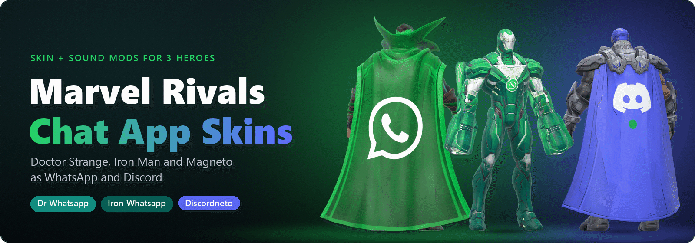
</p>

<p align="center">
<b>Doctor Strange, Iron Man and Magneto turned into chat apps.</b><br>
New skins, a WhatsApp or Discord sound on every ability, and optional effects to match.
</p>

<p align="center">


<br>

</p>

## Read this first

> [!CAUTION]
> **These mods break Marvel Rivals' Terms of Service and CAN GET YOUR ACCOUNT BANNED, temporary or permanent.**
>
> - **There's no such thing as a safe mod here.** Skins and sounds included. The ASI loader and the two plugins they need also change how the game loads files, which is the kind of thing anticheat looks for.
> - **The optional effects paks (Iron Whatsapp's green beams, Discordneto's blurple effects) change VFX, which is the riskiest kind of mod.** They're separate downloads on purpose. Skip them if you want to keep the risk lower.
> - **Use everything here at your own risk.** If you can't afford to lose the account, don't install it. Never use mods in ranked or tournaments.
> - This is a fan project. It's **not affiliated with or endorsed by NetEase, Marvel, Meta / WhatsApp or Discord.**

<p align="center">
<a href="#the-lineup"><b>The lineup</b></a> &nbsp;·&nbsp;
<a href="#original-whatsapp">Original Whatsapp</a> &nbsp;·&nbsp;
<a href="#dr-whatsapp">Dr Whatsapp</a> &nbsp;·&nbsp;
<a href="#discordneto">Discordneto</a> &nbsp;·&nbsp;
<a href="#iron-whatsapp">Iron Whatsapp</a>
<br>
<a href="#install"><b>Install</b></a> &nbsp;·&nbsp;
<a href="#after-a-game-update">After a game update</a> &nbsp;·&nbsp;
<a href="#faq-and-troubleshooting">FAQ</a> &nbsp;·&nbsp;
<a href="#credits">Credits</a>
</p>

## The lineup

<p align="center">
<a href="#original-whatsapp">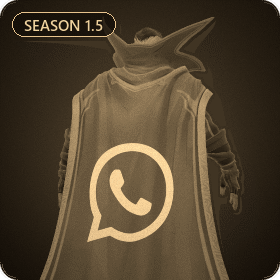</a>
<a href="#dr-whatsapp">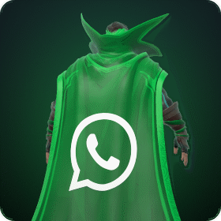</a>
<a href="#discordneto">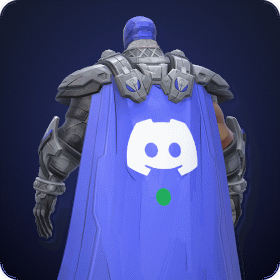</a>
<a href="#iron-whatsapp">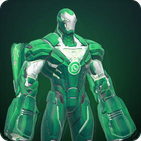</a>
</p>

| Mod | Hero | Sounds | Effects | Works now? | Made by |
| --- | --- | --- | --- | --- | --- |
| [Original Whatsapp](#original-whatsapp) | Doctor Strange | ult and portals | - | no, broke in Season 2 | Omono |
| [**Dr Whatsapp**](#dr-whatsapp) | Doctor Strange | 13 WhatsApp sounds + the original ult | - | **yes** | Omono, revived by me |
| [**Discordneto**](#discordneto) | Magneto | 34 Discord sounds on 37 moments | optional blurple effects | **yes** | me |
| [**Iron Whatsapp**](#iron-whatsapp) | Iron Man | 15 classic WhatsApp sounds on 16 moments | optional green beams | **yes** | me |

All three working mods have their own files and their own sound banks, so you can run them together.

---

## Original Whatsapp

<p align="center"><i>Where it all started: Omono's WhatsApp Doctor Strange from Season 1.5.</i></p>

<p align="center">

</p>

The first Dr Whatsapp was made by **Omono** and is on Nexus: **[Dr Whatsapp on Nexus Mods](https://www.nexusmods.com/marvelrivals/mods/974)**. Green Strange, a big WhatsApp logo on the cape, and WhatsApp sounds on his ult and portals. The art and the ult sounds in Dr Whatsapp are Omono's.

It stopped working after Season 2. The game changed how it loads skin mods, the texture format got new fields, and Strange's sound banks changed a lot. So the Season 1.5 files just get ignored or break his sounds now.

| | Original Whatsapp (Season 1.5) | Dr Whatsapp (this repo) |
| --- | --- | --- |
| Skin files | one old style `.pak`, ignored since Season 2 | IoStore `.pak` + `.utoc` + `.ucas`, textures moved to the new layout |
| Sounds | whole voice and sfx banks from Feb 2025, swapped in | only the sounds that changed, put into today's banks |
| Abilities with a WhatsApp sound | the ult and the portals | every ability, plus the original ult |
| Junk `patched_files` entry | yes | removed |
| Works on the current patch | no | yes, build 1.1.3962284 |

The original rars are kept in [`original\`](original) because `build.py` builds Dr Whatsapp from them. Don't install them on today's game. The whole story is in [Why the old files broke](docs/DR_WHATSAPP.md#why-the-old-files-broke).

---

## Dr Whatsapp

<p align="center"><i>Omono's skin, working again, and now every ability is a WhatsApp notification.</i></p>

<p align="center">
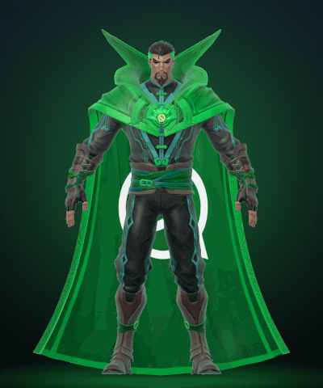
</p>

### What's in it

- Omono's green Strange: WhatsApp green suit, cape and collar
- Big WhatsApp logo on the back of the cape, a small one in the Eye of Agamotto
- His grey hair streak goes green
- **13 WhatsApp sounds**, one for every ability, taken from WhatsApp for Windows (the alert tones, the notification, the ringtone and the hang up)
- Omono's original ult voice line and impact, kept as they were
- An obfuscated copy of the skin, in case the normal one doesn't show up

**Files:** `DrWhatsapp_9999999_P` (skin) and `68_DoctorWhatsappSounds_9999999_P.pak` (sounds). Default costume only.

### Before and after

<p align="center">
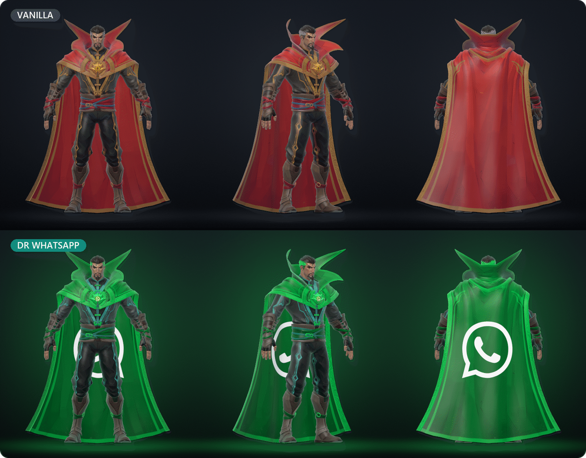
</p>

### Sound highlights

| Key | Ability | WhatsApp sound |
| --- | --- | --- |
| Left click | Daggers of Denak | message notification, every volley |
| Right click | Shield of the Seraphim | alert tone 6 |
| Shift | Cloak of Levitation | alert tone 2 |
| E | Gamma Maelstrom (Hulk team-up) | alert tone 9 |
| F | Portals open | **the incoming call ringtone** |
| F | Portals close | call hang up |
| Q | Eye of Agamotto | Omono's original ult voice line and impact |

<details>
<summary><b>More pictures</b></summary>
<br>
<p align="center">
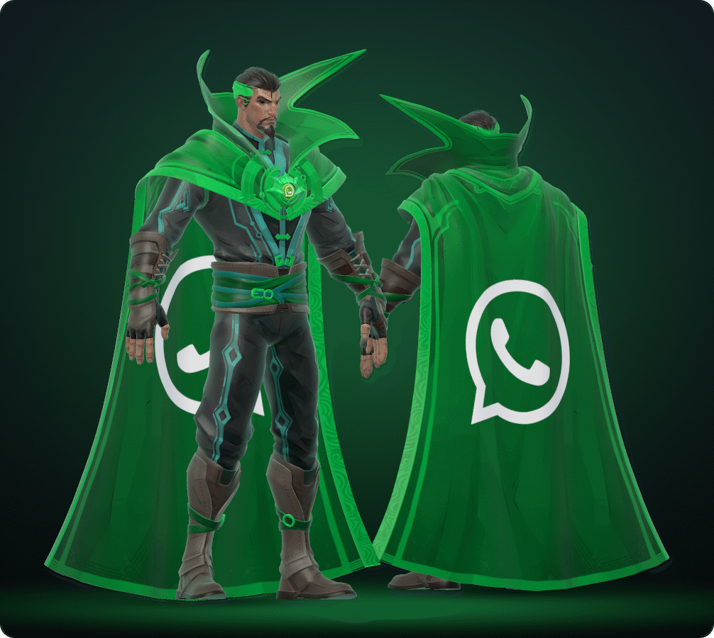
</p>
</details>

<p align="center">
<a href="docs/DR_WHATSAPP.md"><b>Full notes</b></a> &nbsp;·&nbsp;
<a href="audio/SOUNDS.md"><b>All 13 sounds</b></a> &nbsp;·&nbsp;
<a href="audio/preview"><b>Sound previews (.wav)</b></a>
</p>

---

## Discordneto

<p align="center"><i>Discord Magneto. Blurple everything, Clyde on the cape, and his ult is a whole Discord call.</i></p>

<p align="center">
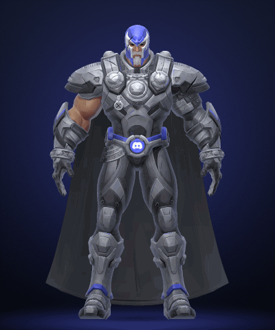
</p>

### What's in it

- Blurple helmet with white face stripes, Discord greys on the armour, blurple trim
- Blurple cape with a big white Clyde and a green online dot, Discord dark grey inside
- A round Clyde badge in the belt buckle
- Sword, ring and cannon in Discord grey with blurple bits
- **34 Discord sounds on 37 moments** from the Discord client and the soundboard, with the **real incoming call ringtone** on the ult and the airhorn, quack and sad horn in there too
- **Optional:** his purple ability effects in Discord blurple (see below)

**Files:** `DiscordMagneto_9999999_P` (skin) and `70_DiscordMagnetoSounds_9999999_P.pak` (sounds). Default costume (1037102 gets it too).

### Before and after

<p align="center">
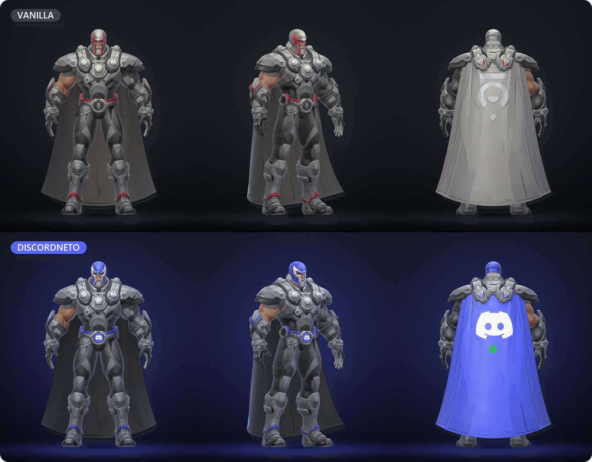
</p>

### Sound highlights

Every ability is one Discord feature, so you can tell them apart with your eyes shut.

| Key | Ability | Discord sound |
| --- | --- | --- |
| Left click | Iron Volley | the message ping |
| Right click | Mag-Cannon | a viewer joins the stream on 1 ring, Go Live cut short on 2, the full Go Live run on 3, and **the airhorn** on a full-ring knock-back |
| Shift | Metallic Curtain | deafen / undeafen |
| E and F | Bulwark shields | mute / unmute |
| Q | Meteor M | **a whole call:** calling, the ringtone while it forms, someone joined when you throw it, disconnect on impact |
| Q | Meteor broken before the throw | soundboard sad horn |
| V | Melee hit | soundboard quack |
| Death | Magneto dies | someone left the voice channel |

### Optional: blurple effects

> [!WARNING]
> **The effects pak changes VFX, the riskiest kind of mod there is.** On top of the ban risk above, broken or outdated effect mods are the usual reason for "client modified" at login. If you add it anyway, try it on its own first, and if anything goes wrong delete the 3 `DiscordMagnetoFX_9999999_P` files.

The purple in Iron Volley, Mag-Cannon, Metallic Curtain, Iron Bulwark, Meteor M, the greatsword, the iron rings and Magnetic Descent goes Discord blurple (#5865F2), and the Emma Frost team-up goes blurple too. Only colours change, nothing about size, timing or strength. Enemies keep their red, and every Magneto costume gets the blurple effects with this on.

<details>
<summary><b>Every effect colour, vanilla vs Discord</b></summary>
<br>
<p align="center">
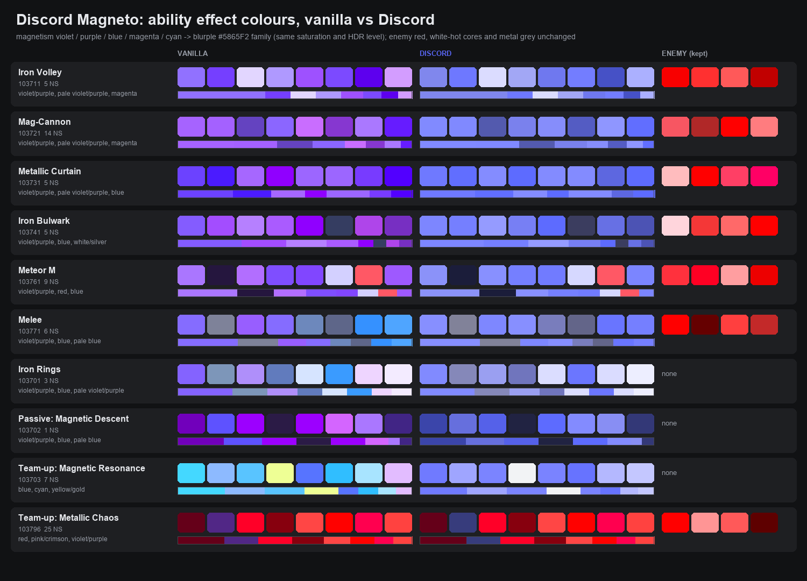
</p>
</details>

<details>
<summary><b>More pictures</b></summary>
<br>
<p align="center">
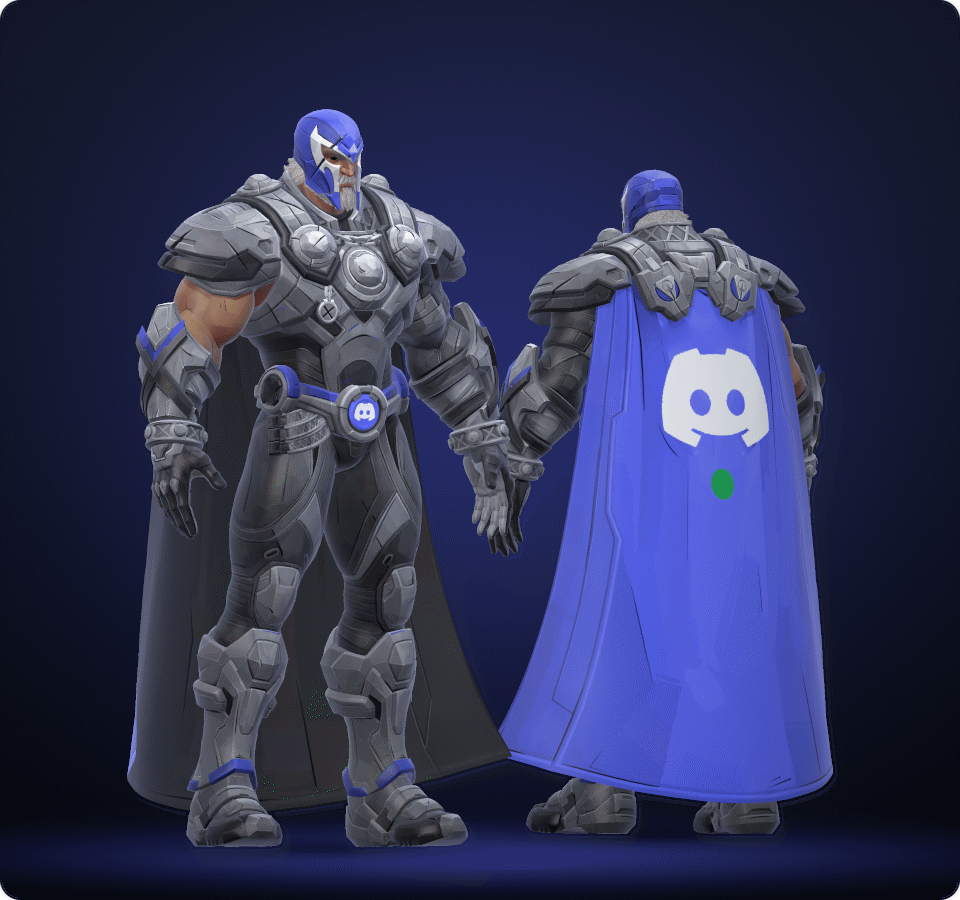
<br><br>
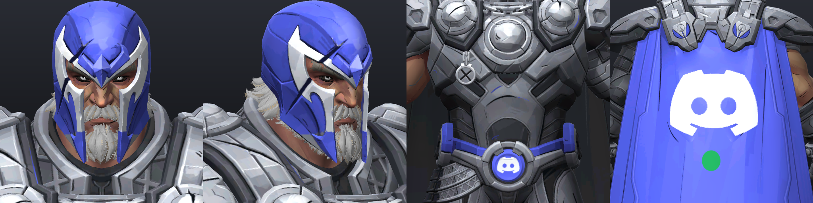
</p>
</details>

<p align="center">
<a href="magneto/README.md"><b>Full notes</b></a> &nbsp;·&nbsp;
<a href="magneto/SOUNDS.md"><b>All 37 moments</b></a> &nbsp;·&nbsp;
<a href="magneto/SOUNDS_PLAN.md"><b>Sound plan</b></a> &nbsp;·&nbsp;
<a href="magneto/preview"><b>Sound previews (.wav)</b></a>
</p>

---

## Iron Whatsapp

<p align="center"><i>Tony switched to WhatsApp. Green armour, logos front and back, classic phone sounds.</i></p>

<p align="center">
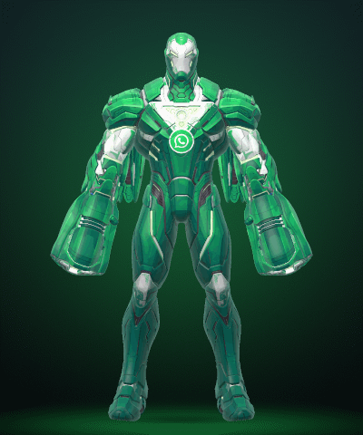
</p>

### What's in it

- Red goes WhatsApp green, gold goes white, the blue glow lines go green
- WhatsApp logo on the stomach plate under the arc reactor and in the middle of the back
- Tony's face stays normal for the helmet-off moments
- **A classic WhatsApp sound on every ability** (15 sounds on 16 moments) from the phone app and WhatsApp Web: message pops, call tones, voice note blips and the old 2016 web ding
- None of them are Dr Whatsapp's sounds, so you can run both
- **Optional:** green Repulsors, Unibeam, missiles and ult (see below)

**Files:** `IronWhatsapp_9999999_P` (skin) and `69_IronWhatsappSounds_9999999_P.pak` (sounds). Default costume only.

### Before and after

<p align="center">
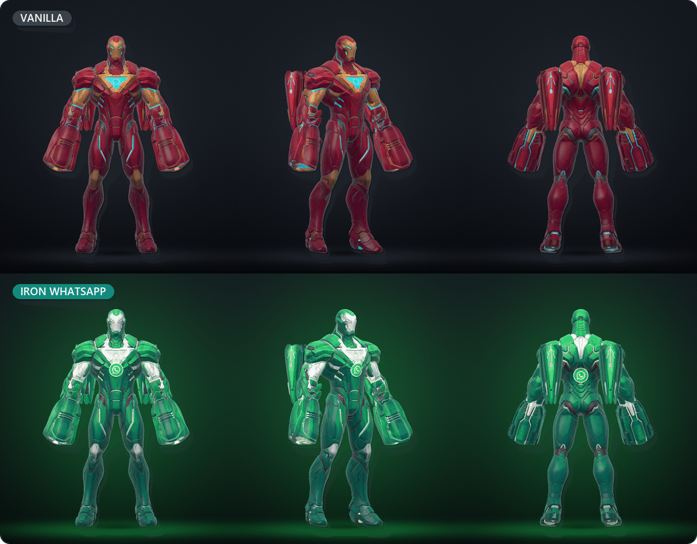
</p>

### Sound highlights

| Key | Ability | WhatsApp sound |
| --- | --- | --- |
| Left click | Repulsor shots | message sent pop, message received pop on the 3rd shot |
| Right click | Unibeam | call connected, the **"Calling..." tone while you hold it**, hang up at the end |
| Shift | Hyper-Velocity | someone joined the call / someone left the call |
| E | Armor Overdrive | **the old 2016 WhatsApp Web ding** |
| F | Micro-Missiles | voice note record click |
| Q | Pulse Cannon | group call ringtone while it charges, group call connected when it fires |
| R | Reload | voice note sent |

### Optional: green beams

> [!WARNING]
> **The beams pak changes VFX, the riskiest kind of mod there is.** On top of the ban risk above, broken or outdated effect mods are the usual reason for "client modified" at login. If you add it anyway, try it on its own first, and if anything goes wrong delete the 3 `IronWhatsappBeams_9999999_P` files.

The Repulsors, Unibeam, Micro-Missiles, Pulse Cannon and the Armor Overdrive and Hyper-Velocity glows go WhatsApp green, team-up versions included. Only the colour changes, not the size or strength. Enemy Iron Men keep the red the game gives them, and every Iron Man costume fires green with this on, not just the default one.

<details>
<summary><b>More pictures</b></summary>
<br>
<p align="center">
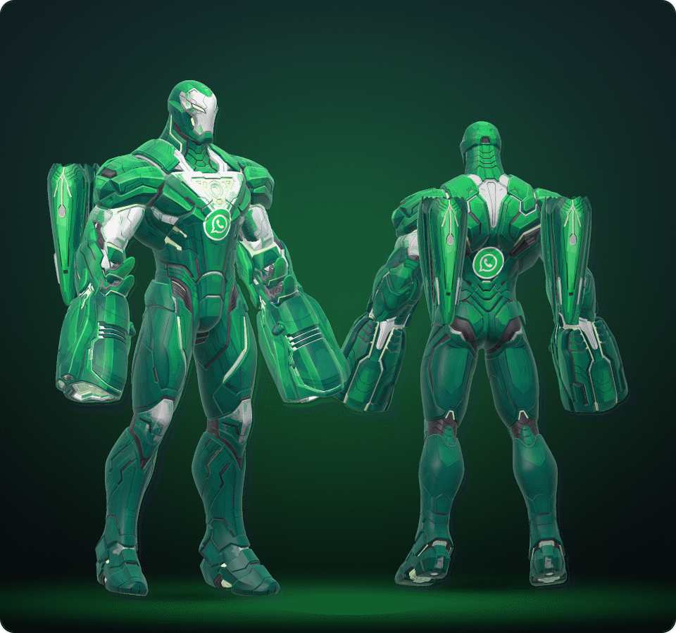
</p>
</details>

<p align="center">
<a href="ironman/README.md"><b>Full notes</b></a> &nbsp;·&nbsp;
<a href="ironman/SOUNDS.md"><b>All 16 moments</b></a> &nbsp;·&nbsp;
<a href="ironman/preview"><b>Sound previews (.wav)</b></a>
</p>

---

## Install

> [!IMPORTANT]
> Read the [ban warning](#read-this-first) before you install anything. Close the game before you copy files.

### 1. Get the requirements (one time)

These go in `MarvelRivals\MarvelGame\Marvel\Binaries\Win64\`. Nothing loads without them.

| # | What | Goes in | Where to get it |
| --- | --- | --- | --- |
| 1 | **Ultimate ASI Loader** v7.7.0, as `dsound.dll` | `Binaries\Win64\` | [GitHub releases](https://github.com/ThirteenAG/Ultimate-ASI-Loader/releases). Stay on v7.7.0, people say 9.x doesn't work with the bypass. |
| 2 | **UTOC Signature Bypass** | `Binaries\Win64\plugins\` | [Nexus Mods](https://www.nexusmods.com/marvelrivals/mods/2940) |
| 3 | **Unmount Blocker** | `Binaries\Win64\plugins\` | [Nexus Mods](https://www.nexusmods.com/marvelrivals/mods/12735). Needed since the Sept 3 2026 patch, otherwise the game unmounts everything in `~mods` when you log in. Only get it from that Nexus page, there are fake copies on GitHub. |

### 2. Download

Grab what you want from the **[latest release](https://github.com/KarimElkashef8236/Marvel-Rivals-Chat-App-Skins/releases/latest)**:

| Zip | What's inside |
| --- | --- |
| `DrWhatsapp.zip` | skin + sounds, plus the obfuscated fallback skin |
| `IronWhatsapp.zip` | skin + sounds, the green beams in `optional-beams\` |
| `Discordneto.zip` | skin + sounds, the blurple effects in `optional-effects\` |
| `All-Three.zip` | all of the above in one zip |

### 3. Copy the files

Copy the `~mods` folder from the zip into the game's `Paks` folder, so the files end up here:

```
...\MarvelRivals\MarvelGame\Marvel\Content\Paks\~mods\
```

On Steam you find the game folder with right click on Marvel Rivals > Manage > Browse local files. The folder has to be called exactly `~mods`. Want the optional effects? Copy the files from `optional-beams\` or `optional-effects\` into that same `~mods` folder.

<details>
<summary><b>What <code>~mods</code> looks like with everything in</b></summary>

```
~mods\
  DrWhatsapp_9999999_P.pak / .utoc / .ucas            Dr Whatsapp skin
  68_DoctorWhatsappSounds_9999999_P.pak               Dr Whatsapp sounds
  IronWhatsapp_9999999_P.pak / .utoc / .ucas          Iron Whatsapp skin
  69_IronWhatsappSounds_9999999_P.pak                 Iron Whatsapp sounds
  IronWhatsappBeams_9999999_P.pak / .utoc / .ucas     optional green beams
  DiscordMagneto_9999999_P.pak / .utoc / .ucas        Discordneto skin
  70_DiscordMagnetoSounds_9999999_P.pak               Discordneto sounds
  DiscordMagnetoFX_9999999_P.pak / .utoc / .ucas      optional blurple effects
```

Skins and effects are always 3 files (`.pak`, `.utoc`, `.ucas`) that belong together. The sounds are a single plain `.pak` on purpose, audio mods don't work as IoStore.

</details>

### Or use the install script

If you cloned the repo, `scripts\install.py` does the copying for you. It only needs Python 3.

| You want | Run |
| --- | --- |
| Dr Whatsapp | `python scripts\install.py` |
| Iron Whatsapp | `python scripts\install.py --hero ironman` |
| Iron Whatsapp + green beams | `python scripts\install.py --hero ironman --beams` |
| Discordneto | `python scripts\install.py --hero magneto` |
| Discordneto + blurple effects | `python scripts\install.py --hero magneto --effects` |
| Dr Whatsapp + Iron Whatsapp | `python scripts\install.py --hero both` |
| All three | `python scripts\install.py --hero all` (add `--beams` and/or `--effects` for the extras) |
| Dr Whatsapp with the obfuscated skin | `python scripts\install.py --obfuscated` |
| Take a hero out again | `python scripts\install.py --hero ironman --uninstall` (or `strange`, `magneto`, `all`) |

It looks for the game in `D:\SteamLibrary\...` because that's where mine is, so add `--game "<your path>\MarvelGame\Marvel\Content\Paks"` if yours is somewhere else. It won't copy while the game is running, and it tells you if it can't find one of the three requirements. Running it again without `--beams` or `--effects` takes those back out.

### Uninstall

Delete that mod's files from `~mods` (or the whole `~mods` folder), or use `--uninstall` like in the table above. Uninstalling a hero takes its optional effects out too.

> [!TIP]
> Keep a copy of your `~mods` folder somewhere else. The launcher's "clear redundant files" can delete it.

---

## After a game update

Patches can break mods. Usually the sounds go back to vanilla or quiet because the hero's sound bank changed, or nothing loads until the bypass and the Unmount Blocker get updated. Check the [releases](https://github.com/KarimElkashef8236/Marvel-Rivals-Chat-App-Skins/releases) for rebuilt zips first, or rebuild them yourself.

### Build it yourself

You need Windows, the game installed, and Python 3 with `numpy` and `cryptography`:

```
pip install numpy cryptography
python scripts\build.py
python scripts\build_ironman.py
python scripts\build_magneto.py
```

Add `--game "<your path>\MarvelGame\Marvel\Content\Paks"` to each one if your game isn't on D:, then install like above. `build.py` builds Dr Whatsapp from Omono's rars in `original\` and grabs retoc-rivals-cli v3.9.3 into `tools\` the first time (checked against its sha256). The Iron Man and Magneto builds need that too, so run `build.py` first. Every build reads the current game files and checks each thing it changes against what it expects, so if a patch moved something it stops and tells you instead of making a broken pak.

The per-hero notes say what to look at when a build stops: [Dr Whatsapp](docs/DR_WHATSAPP.md#after-a-game-update), [Iron Whatsapp](ironman/README.md#after-a-game-update), [Discordneto](magneto/README.md#after-a-game-update).

<details>
<summary><b>What's where in this repo</b></summary>

```
original\         Omono's Season 1.5 rars (Dr Whatsapp is built from them)
dist\             Dr Whatsapp, ready to install (~mods and fallback-obfuscated)
audio\            Dr Whatsapp's sounds.json, the WhatsApp sounds and the previews
ironman\          Iron Whatsapp: readme, sounds, decals, previews and dist\
magneto\          Discordneto: readme, sounds, sound plan, logos, previews and dist\
scripts\          build and install scripts, pak, soundbank and texture tools
scripts\preview\  the renderer that made the pictures on this page
docs\             Dr Whatsapp's full notes and the pictures for this page
```

</details>

---

## FAQ and troubleshooting

<details>
<summary><b>Is it safe? Can I get banned?</b></summary>
<br>

No, it isn't safe, and yes, you can. Modding breaks Marvel Rivals' Terms of Service and any mod can get your account banned, temporary or permanent. The effects paks are the riskiest part. If you care about the account, don't use mods. See [Read this first](#read-this-first).

</details>

<details>
<summary><b>The skin doesn't show up</b></summary>
<br>

- Check the folder is called exactly `~mods` and sits in `MarvelGame\Marvel\Content\Paks\`.
- A skin is 3 files (`.pak`, `.utoc`, `.ucas`) and all 3 have to be there.
- You need all three requirements, the Unmount Blocker especially, or the game drops everything in `~mods` when you log in.
- Use the default costume. The skins only change that one.
- Dr Whatsapp: try the obfuscated skin from `fallback-obfuscated\` instead of the normal skin files (not next to them).
- If you have the optional high-res texture download, the closest zoom level of Iron Whatsapp and Discordneto can show the old colours. Dr Whatsapp can look vanilla from really far away.

</details>

<details>
<summary><b>"Client modified" or I can't log in</b></summary>
<br>

That's the game noticing changed files, so take it seriously.

- Take the effects paks out first (`IronWhatsappBeams_*` and `DiscordMagnetoFX_*`). Broken or outdated effect mods are the most common cause.
- Right after a patch, the mods or the bypass and Unmount Blocker can be out of date. Wait for updates, or rebuild.
- Still stuck? Empty `~mods` and see if the game starts clean. If it doesn't, the problem is the loader or the plugins, not these mods.

</details>

<details>
<summary><b>The sounds are still vanilla (or silent)</b></summary>
<br>

- A patch probably changed that hero's sound bank. Get a newer release or [rebuild](#build-it-yourself).
- The sound paks need the Unmount Blocker too.
- Leave the sound `.pak` files as they are. Don't convert them to IoStore, audio mods only work as plain paks.
- If another player uses a different costume of the same hero, some sounds can swap back to vanilla, because the game keeps whichever copy of a sound loads first. That's not your install.
- Dr Whatsapp's ult voice line only replaces English voice.

</details>

<details>
<summary><b>The launcher deleted my <code>~mods</code> folder</b></summary>
<br>

The launcher's "clear redundant files" can do that. Keep a copy of `~mods` somewhere else and paste it back.

</details>

<details>
<summary><b>Can other players see or hear it?</b></summary>
<br>

No. It all happens on your PC, everyone else sees and hears the normal game unless they have the mods too. On your screen it works on other players as well: an enemy Strange on his default costume shows up as Dr Whatsapp, and you hear the ringtone when he opens portals.

</details>

<details>
<summary><b>Can I run all three at once?</b></summary>
<br>

Yes. They use different files and different sound banks, and Iron Whatsapp doesn't use any of Dr Whatsapp's sounds. `python scripts\install.py --hero all` puts them all in.

</details>

<details>
<summary><b>Does it work on other costumes?</b></summary>
<br>

The skins are for the default costumes (Magneto's 1037102 shares the textures, so it turns into Discordneto too). The sounds sit in the default costume's sound bank, which almost every Magneto costume and two Iron Man costumes (1034100 and 1034501) use as well, so they get the sounds too. The optional effects show on every costume of that hero. The details are in each hero's notes.

</details>

---

## Credits

- **Omono** made the original Dr Whatsapp ([Nexus Mods](https://www.nexusmods.com/marvelrivals/mods/974)). The Dr Whatsapp art and the ult sounds are theirs. I only got it working again and added the other sounds. Omono's Nexus permissions let anyone upload and modify it as long as Omono is credited, and not in anything that's sold or earns donation points. This repo is free and always will be. Go endorse the original.
- **natimerry** for [repak-rivals and retoc-rivals](https://github.com/natimerry/repak-rivals). Every skin and effects pak is packed with retoc-rivals, and the sound paks are written by `rivalspak.py`, which follows how repak-rivals does it.
- The people behind the **Ultimate ASI Loader** (ThirteenAG), the **UTOC Signature Bypass** and the **Unmount Blocker**. Nothing loads without them.
- The WhatsApp sounds and logo belong to **Meta / WhatsApp**. The Discord sounds, Clyde and the Discord logo belong to **Discord**. **Marvel Rivals** belongs to **NetEase Games** and **Marvel**.
- Iron Whatsapp, Discordneto, the sound mapping, the build scripts and the preview renderer are mine.

<p align="center">
<sub>Fan project, not affiliated with or endorsed by NetEase, Marvel, Meta / WhatsApp or Discord. Mods break the game's Terms of Service and can get you banned. Use at your own risk.</sub>
</p>
