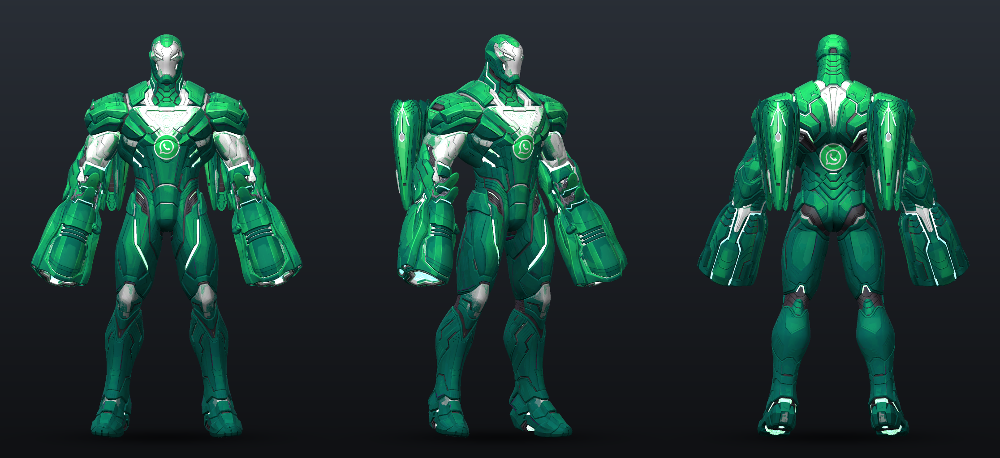

# WhatsApp Iron Man (Iron Whatsapp)

[Back to the main page](../README.md)

Iron Man in WhatsApp green, with the WhatsApp logo on his stomach and back, a classic WhatsApp sound on every ability, and optional green beams.

Same idea as Dr Whatsapp, but this one is all mine: the skin is recoloured from the game's own Iron Man, and the sounds are the classic WhatsApp phone and web sounds. None of them are the sounds Dr Whatsapp uses, so you can run both mods at the same time.

Built against game build 1.1.3962284 (Oct 22 2026 patch).

> [!CAUTION]
> **Mods break Marvel Rivals' Terms of Service and can get your account banned, temporary or permanent.** That goes for skin and sound mods like this one too, and the optional green beams change VFX, which is the riskiest kind of mod. Use it at your own risk and never in ranked or tournaments. More in the [warning on the main page](../README.md#read-this-first).



## What's in it

| File | What |
| --- | --- |
| `dist\~mods\IronWhatsapp_9999999_P.pak/.utoc/.ucas` | the skin |
| `dist\~mods\69_IronWhatsappSounds_9999999_P.pak` | the sounds |
| `dist\optional-beams\IronWhatsappBeams_9999999_P.pak/.utoc/.ucas` | green Repulsors, Unibeam, missiles, ult and Armor Overdrive, team-up versions included (optional, read the part about it below) |

**Skin:** the colour, shine and glow textures of the default costume's armour and weapons. Red goes to WhatsApp green, gold to white, the blue glow lines to green, and there's a WhatsApp logo on the stomach plate under the arc reactor and in the middle of the back. Tony's face stays normal for the helmet-off moments. It's basically only the default costume: the one exception I found is the Iron Pharaoh costume's railgun (and a map prop and a Hulk MVP scene), which reuse one of the default railgun's shine textures, so they get a bit of the green shine too. The preview above is the real Iron Man model from the game rendered with the textures straight out of the built mod.

## Install

You need the same stuff as Dr Whatsapp in `MarvelGame\Marvel\Binaries\Win64\` (Ultimate ASI Loader, UTOC Signature Bypass, Unmount Blocker, see [the requirements on the main page](../README.md#1-get-the-requirements-one-time)). Then close the game and run:

```
python scripts\install.py --hero ironman
```

That's the skin and the sounds. Add `--beams` for the green beams, or use `--hero both` to put Dr Whatsapp and Iron Man in at once. `--uninstall` takes Iron Man out again (beams included). You can also just copy the files from `dist\~mods\` into `...\Content\Paks\~mods\` yourself, or grab `IronWhatsapp.zip` from the [releases](https://github.com/KarimElkashef8236/Marvel-Rivals-Chat-App-Skins/releases/latest).

## Sounds

Previews are in `preview\`, named by key and ability. Every version of each ability gets it (normal, Armor Overdrive and the team-up versions), for you, your teammates and enemies.

| Key | Ability | WhatsApp sound |
| --- | --- | --- |
| Left click | Repulsor shots 1 and 2 | message sent pop |
| Left click | Repulsor 3rd shot | message received pop |
| Left click | Repulsor in Armor Overdrive | voice note blip (up) |
| Right click | Unibeam fire | call connected |
| Right click | Unibeam held | Calling... tone, over and over |
| Right click | Unibeam end | call hang up |
| Shift | Hyper-Velocity start | someone joined the call |
| Shift | Hyper-Velocity stop | someone left the call |
| F | Micro-Missile launch | voice note record click |
| E | Armor Overdrive on | the old 2016 WhatsApp Web ding |
| E | Armor Overdrive off | left the group call |
| Q | Pulse Cannon charge | group call ringtone |
| Q | Pulse Cannon fire | group call connected |
| Q | Pulse Cannon end | call hang up |
| V | Melee | voice note blip (down) |
| R | Reload | voice note sent |

More detail in `SOUNDS.md`. The ult voice line ("Maximum pulse!") stays vanilla, same for hits, explosions, the flight loop and the missile trails. The little charge clicks right before the Repulsor and missile shots are muted so the WhatsApp sound comes through clean. Three vanilla layers keep playing quietly under the ult shot, the Overdrive Unibeam and Hyper-Velocity stop, because other heroes' banks use the exact same sounds and muting them would change those heroes too.

The sounds come from WhatsApp itself: the message sent pop, the 2016 web ding and the voice note blips from WhatsApp's own servers, the rest out of the official WhatsApp Android app (the sounds sit in its `res` folder). They're Meta's sounds, not mine, I just put them on Iron Man's abilities.

## About the beams

The green beams are their own pak on purpose. They're the riskiest part:

- **This changes VFX, which is the riskiest kind of mod.** Mods break the ToS and can get your account banned (temporary or permanent), and effect mods are a step riskier than skins and sounds. Broken or outdated VFX mods are also the most common reason people get kicked at login. Only add it if you accept that. Try it on its own first, and if you get "client modified" or can't log in, delete the 3 `IronWhatsappBeams` files.
- Iron Man has one set of beam effects for every costume, so every Iron Man costume fires green with this on, not just the default one.

How it works: most of the beam colour isn't in the materials at all. Every effect has a small script that picks a colour for you and your team and a red one for enemies, once for the whole effect and again for each particle, and the materials just take whatever it picks. The pak only changes the colours picked for you and your team, so enemy Iron Men keep the red the game gives them. Where an effect never had an enemy version (it was blue for everyone), it's green for everyone now.

What's covered: Repulsors (and the impact flash), Unibeam, Micro-Missiles, Pulse Cannon, the Armor Overdrive and Hyper-Velocity glows, the Armor Overdrive versions of all of those, the team-up versions (since the September patch those live in a separate folder) and the Repulsor hits that play when a shot gets frozen. Only the colour changes, not the size or the strength of the effects, and the green is eased to about the same brightness the blue had. The missiles' orange fire stays orange.

Other heroes don't change: a few of Iron Man's effect materials are also used by Magneto, Emma Frost, Mantis and others, so Iron Man gets his own green copies of those and everyone else keeps the originals. Iron Man's hero colour setting stays untouched too (Groot's Aircraft emote reads it), the effects in this pak just use the green instead of reading it. Same goes for the colour ramp: the Oct 22 patch gave a monster in the new Thanos PvE mode a trail that reads the same ramp row as the Repulsor trail, so that row stays blue now and the Repulsor trail reads its own green copy of it.

What's left:

- Team-up effects that borrow the partner's own materials keep the partner's colour, like the Storm style lightning and shimmer in the Thor and Storm team-ups.
- The sparks when the Pulse Cannon hits have their colour compiled into the game's shaders, which a mod file can't change, so they stay blue. The sparkles on each Repulsor shot have that problem too, but their material got pointed at a green colour ramp, which should tint them green.
- Three rows of a shared colour ramp are left alone because other heroes read them, which leaves a hint of blue in a few glows.
- Iron Man's other costumes reuse some of these effects (flight, nano and hover glows), so they get partly green too, and so do a few of their MVP and lobby intros.
- The gauntlet and back-gun glow on the armour itself stays blue (that comes from materials the September patches changed, and I didn't want to undo patch changes).
- The Oct 22 patch remade one team-up hit effect (`NS_103486_Hit_01`): it took out some of its parts and changed how one of its glowing balls picks its colour. The parts that didn't change are still green, but that ball now shows the game's own blue for you and your team.

## Notes

- Costumes 1034100 and 1034501 don't have their own sound bank, so they get the WhatsApp sounds too (but keep their normal look).
- Some of these sound ids are also in the banks for Iron Man's other costumes and in the Ultron PvE bank, and Wwise keeps whichever copy loads first. So if another Iron Man in the match uses a different costume, some sounds can end up the same for both of you (either WhatsApp or vanilla). Same thing as with Dr Whatsapp. No other hero's sounds are touched.
- The game has an optional high-res texture download. If you have it, the closest zoom level of the skin can show the old red, because that level lives in a file this mod can't change.
- Mods are against Marvel Rivals' Terms of Service and can get your account banned, temporary or permanent. That includes skin and sound mods like this one, and the beams are riskier still. Use them at your own risk, never in ranked or tournaments, and stay away from config/ini, camera shake or outline mods, people have been banned for those.

## After a game update

```
python scripts\build_ironman.py
python scripts\install.py --hero ironman
```

It pulls everything fresh from the game and rebuilds. The beams build checks every value it changes against what it expects first, so if a patch changed those files it stops instead of making a broken pak. The skin and sounds use the same checks as Dr Whatsapp.

## How it was made

- `scripts\ironman_skin.py`: recolours the textures and writes the new pixels into the game's own texture files in place (`ue_texture.py`, `bc1.py`), then packs them with retoc-rivals.
- `decals\`: the logo, projected onto the stomach and back through the real 3D model once and saved as overlays.
- `sounds.json` + `scripts\make_sounds.py` / `build_audio.py`: same sound system as Dr Whatsapp.
- `beams_plan.json` + `scripts\ironman_beams.py`: every edit the beams pak makes, checked against the original before it's applied. Colour values in materials, colour curves and the colour ramp, plus the colour constants inside the effects' scripts (the new green values go into the script's constant table and just those spots point at them, so nothing else in the script changes), and the Iron Man only material copies.
