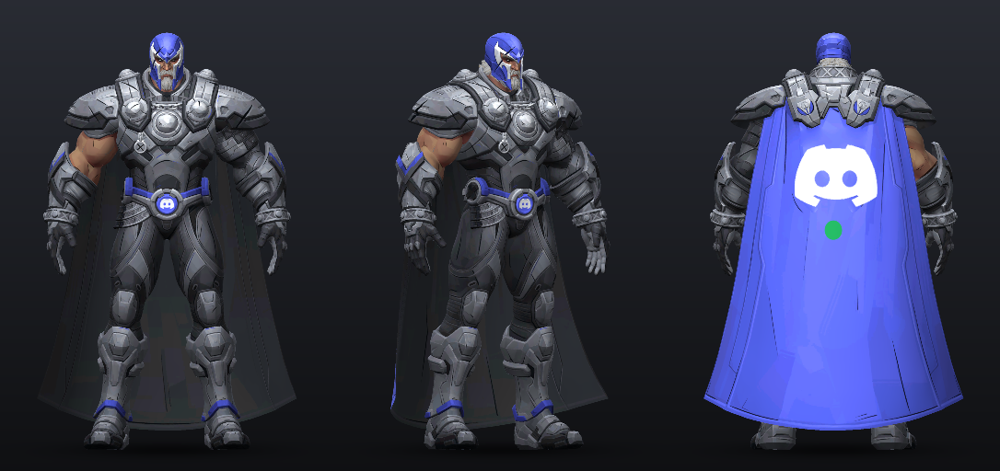
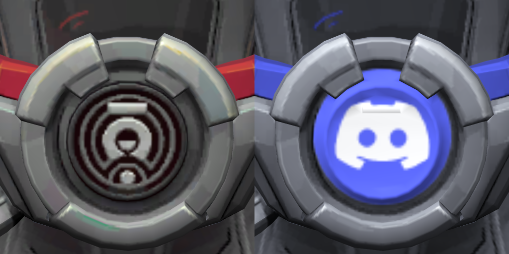

# Discord Magneto (Discordneto)

[Back to the main page](../README.md)

Magneto in Discord colours: blurple trim and Discord greys on the armour, a blurple helmet, and a blurple cape with a big white Clyde (the Discord logo) and a green online dot. Every ability plays a Discord sound, and there's an optional pak that turns his purple ability effects Discord blurple.

Same idea as Dr Whatsapp and WhatsApp Iron Man, but Discord this time. The skin is recoloured from the game's own Magneto and the sounds are Discord's own. It has its own files and only touches Magneto's sound bank, so you can run it next to the other two.

Built against game build 1.1.3962284 (Oct 22 2026 patch).

> [!CAUTION]
> **Mods break Marvel Rivals' Terms of Service and can get your account banned, temporary or permanent.** That goes for skin and sound mods like this one too, and the optional blurple effects change VFX, which is the riskiest kind of mod. Use it at your own risk and never in ranked or tournaments. More in the [warning on the main page](../README.md#read-this-first).






The previews are the real Magneto model from the game, rendered with the recoloured textures. `preview\magneto_weapons.png` has the sword, ring and cannon (vanilla on top, the mod in the middle, the bottom row is a darker version I didn't go with).

## What's in it

| File | What |
| --- | --- |
| `dist\~mods\DiscordMagneto_9999999_P.pak/.utoc/.ucas` | the skin |
| `dist\~mods\70_DiscordMagnetoSounds_9999999_P.pak` | the sounds |
| `dist\optional-effects\DiscordMagnetoFX_9999999_P.pak/.utoc/.ucas` | blurple ability effects (optional, read the part about it below) |

**Skin:** the colour and shine textures of the default costume (1037001). The metal goes to Discord greys (same brightness, just the Discord grey tones), the red trim goes blurple, the helmet dome turns blurple with white face stripes, and the cape turns blurple with a white Clyde and a green online dot where the old helmet emblem was. The inside of the cape is Discord dark grey, the belt buckle gets a round Clyde badge, and the sword, ring and cannon go Discord grey with their rusty brown bits (mostly on the sword) in blurple. The red glow along the cape edges goes blurple too. His face, hair and skin stay normal.

The old emblems on the back of the cape and in the belt buckle are painted out of the shine, bump and roughness textures as well, so their outline doesn't show through the new logos.

## Install

You need the same stuff as Dr Whatsapp in `MarvelGame\Marvel\Binaries\Win64\` (Ultimate ASI Loader, UTOC Signature Bypass, Unmount Blocker, see [the requirements on the main page](../README.md#1-get-the-requirements-one-time)). Then close the game and run:

```
python scripts\install.py --hero magneto
```

That's the skin and the sounds. Add `--effects` for the blurple ability effects (running it again without `--effects` takes them back out). `--hero all` puts Dr Whatsapp, Iron Man and Magneto in at once (add `--beams` for Iron Man's green beams and `--effects` for Magneto's effects). `--hero magneto --uninstall` takes Magneto out again, effects included. You can also just copy the files from `dist\~mods\` (and `dist\optional-effects\` if you want the effects) into `...\Content\Paks\~mods\` yourself, or grab `Discordneto.zip` from the [releases](https://github.com/KarimElkashef8236/Marvel-Rivals-Chat-App-Skins/releases/latest).

## Sounds

Every ability is one Discord feature, so you can tell them apart with your eyes shut: Iron Volley is the chat, Mag-Cannon is streaming, the Curtain is deafen, the Bulwark shields are mute, and the ult is a whole Discord call. Previews are in `preview\`, numbered and named by key and ability.

| Key | Ability | Discord sound |
| --- | --- | --- |
| Left click | Iron Volley | message ping |
| Left click | Iron Volley burst | message ping from the Bop sound pack |
| Right click | Mag-Cannon with 1 / 2 / 3 rings | a viewer joins the stream / Go Live cut short / the whole Go Live run |
| Right click | Mag-Cannon hit | clip saved |
| Right click | Mag-Cannon knock-back | soundboard airhorn |
| Shift | Metallic Curtain up / down | deafen / undeafen |
| Shift | Curtain blocks a shot | a short tink from the old @mention ping |
| E and F | Bulwark shield up / down | mute / unmute |
| Passive | Iron rings 1, 2 and 3 | the headset test ping, 1, 2 or 3 times, so you can count the rings |
| R | Reload | message ping from the ASMR sound pack |
| Q | Meteor M cast | outgoing call (calling tone) |
| Q | Meteor M forming | incoming call ringtone, until you throw it |
| Q | Meteor eats a shot | one quiet note of the "friend started playing" ping |
| Q | Meteor M thrown / impact | someone joined the voice channel (they picked up) / disconnect |
| Q | Meteor broken before the throw | soundboard sad horn |
| V | Melee / melee hit | message ping from the Lofi sound pack / soundboard quack |
| Space | Magnetic Descent start / end | push to talk key pressed / released |
| C | Metallic Chaos (Scarlet Witch team-up) | an Activity starts |
| C | Chaos Greatsword swing / hit | the Discodo easter egg / the Ctrl+/ arrow key beep |
| C | Chaos barrage start / charging / each sword | someone joined the Activity / the Stage waiting drums / the Retro pack ping |
| C | Barrage marks / last mark | a viewer leaves the stream / stream ended |
| X | Magnetic Resonance (Emma Frost team-up) cast / end | camera on / camera off |
| Death | Magneto dies | someone left the voice channel |

That's the short version. `SOUNDS.md` has all 37 moments with clip lengths and when each one plays, and `SOUNDS_PLAN.md` is the plan I made before building: why each sound, the cuts and gains, who hears what and what stays vanilla. The C and X sounds only play when Scarlet Witch or Emma Frost is on your team.

Voice lines stay vanilla ("Fear Magneto!" and the rest), same for the loops (curtain hum, shield hum, descent hum, team-up timer), footsteps and flying. The extra layers that played on top of each ability are muted so the Discord sound comes through clean, except the ones other heroes' banks share too (like the debris under the Iron Volley burst and the big explosion tail under the meteor impact). Those keep playing under it. The E and F cast whoosh stays as well, because Rogue has the same files, so the mute sound plays a moment later when the shield shows up.

The sounds come from Discord itself: the client sounds from Discord's own web client (4 of them are the message pings from the Nitro sound packs) and the airhorn, sad horn and quack from the default soundboard. They're in `discord\`. They're Discord's sounds, not mine, I just put them on Magneto's abilities.

## About the effects

The blurple effects are their own pak on purpose, same as Iron Man's beams:

- **This changes VFX, which is the riskiest kind of mod.** Mods break the ToS and can get your account banned (temporary or permanent), and effect mods are a step riskier than skins and sounds. Broken or outdated VFX mods are also the most common reason people get kicked at login. Only add it if you accept that. Try it on its own first, and if you get "client modified" or can't log in, delete the 3 `DiscordMagnetoFX` files.
- Magneto has one set of ability effects for every costume, so every Magneto costume gets the blurple effects with this on, not just the default one.

What it does: the purple, violet and magenta in Iron Volley, Mag-Cannon, Metallic Curtain, Iron Bulwark, Meteor M, the greatsword, the iron rings and Magnetic Descent goes Discord blurple (#5865F2), at the same strength as before. The glow on his ring and cannon goes blurple too. The Magnetic Resonance team-up with Emma Frost goes blurple and its pale yellow sparkle turns Discord white. The Metallic Chaos team-up keeps Scarlet Witch's reds and pinks, only its purple goes blurple. White-hot cores, grey metal and rock stay as they were. It only changes colours, nothing about the size, timing or strength of the effects.

Enemies keep their red. Wherever the game gives enemies their own red colour, they still see exactly that. Effects that were purple for everyone (no enemy version, or the same purple for enemies) are blurple for everyone now.

Other heroes don't change: some of the materials Magneto's effects use belong to Emma Frost, Scarlet Witch, Iron Man and others, so Magneto gets his own blurple copies of those and everyone else keeps the originals. The pak only has materials, colour ramps, effect systems and a few meshes in it, no animations or ability files.

What stays purple:

- A few layers where enemies see their red through the same colour, so changing it would change what they see: bits of the Iron Volley trail, glow and explosion smoke, the Metallic Curtain lightning and base glow, the Iron Bulwark tile pattern and pop glow, and the Mag-Cannon impact stones. The Iron Bulwark burst around Magneto when he casts it stays fully purple too (it's shared with Rogue's copy of the shield).
- The frozen Mag-Cannon ball is only partly blurple, for the same enemy reason.
- The sword glow, and the ring in the lobby (those are shared with other costumes' lobby and MVP scenes).
- Some Metallic Chaos layers that sit on Scarlet Witch's colours.
- Magnetic Resonance looks a bit darker than Emma's cyan, because blurple is a darker colour.

Side effects: when Rogue copies Magneto's Iron Bulwark, the bubble she puts on her target is blurple too (her cast burst stays purple). The default ring and cannon glow also shows in a few lobby and MVP scenes of other Magneto costumes.

## Notes

- Almost every Magneto costume uses the same sound bank, so the Discord sounds play on most of his costumes, not just the default one. Only 1037300 and 1037304 have their own sounds for some abilities, and they still use this bank for the team-ups, Space and some E and V sounds. No other hero's sounds are touched.
- The skin is mostly the default costume, but a few things share its files:
  - Costume 1037102 uses the same armour, cape and weapon textures, so it becomes a full Discord Magneto too.
  - Costumes 1037100, 1037101, 1037102, 1037500 and 1037501 take their cape edge glow from the default cape, so their glow goes blurple.
  - Costume 1037100 uses the default belt and cape bump maps. Its own buckle and cape emblems keep their colours, but their raised relief goes flat, because those bump maps are smoothed out where the old emblems were.
  - Costume 1037302's sword uses the default sword texture, so it gets the blurple bits too. Some other costumes' lobby and MVP animations show the default sword, so it appears there in Discord colours.
  - The cannon's texture also colours Magneto's rock and metal effects (Iron Volley shards, the lobby rocks, the 1037300 MVP stones), so they pick up the same slightly cooler Discord grey.
  - No other hero's textures or materials are changed.
- The game has an optional high-res texture download. If you have it, the closest zoom level of the skin can show the old colours, because that level lives in a file this mod can't change.
- Enemies hear the Iron Volley ping 4 semitones lower and allies hear the meteor impact a bit lower. The game pitches those itself and the same file plays for everyone, so it can't be right for all of them.
- If someone breaks the meteor before you throw it, the ringtone keeps going under the sad horn until it runs out. The game has no stop for that moment (same as the vanilla rumble).
- A few spiky sounds (melee, melee hit, iron ring 2, the meteor throw, the Mag-Cannon hit) come out 4 to 7 dB quieter than planned, because their peaks hit the ceiling before they get to the target level.
- Mods are against Marvel Rivals' Terms of Service and can get your account banned, temporary or permanent. That includes skin and sound mods like this one, and the effects are riskier still. Use them at your own risk, never in ranked or tournaments, and stay away from config/ini, camera shake or outline mods, people have been banned for those.

## After a game update

```
python scripts\build_magneto.py
python scripts\install.py --hero magneto --effects
```

It pulls everything fresh from the game and rebuilds. The skin stops if a texture it needs isn't in the game any more, the cape glow only changes if the colours are still the ones it expects (otherwise it says so and leaves the glow red), and it warns if the model changed in a way that could make him vanilla from far away. The sounds use the same checks as Dr Whatsapp. The effects build checks every value it changes against what it expects first, so if a patch changed one of those files it stops instead of making a broken pak. That happened with the Oct 1 patch (1.1.3913745), which changed one of the materials it copies, so the plan got updated for it. It happened again with the Oct 22 patch (1.1.3962284): the game shipped almost all of Magneto's effect files again, the Iron Volley burst got saved again with new names for its colour curves, and the ring mesh got cooked again. The colours it changes are the same as before, so the plan just points at the new files now. That patch also took a few variants out of the ally and enemy versions of some sounds (Mag-Cannon, Curtain blocks a shot, Bulwark shield down, Chaos barrage sword), so those 12 sound ids aren't in `sounds.json` any more. Everyone still hears the same Discord sounds.

## How it was made

- `scripts\magneto_skin.py`: recolours the textures and writes the new pixels into the game's own texture files in place (`ue_texture.py`, `bc1.py`, and `bc5.py` for the bump maps), then packs them with retoc-rivals. Only the spots around the old emblems get touched on the bump and roughness maps, the rest stays byte for byte the game's.
- `decals\`: the Clyde overlays for the cape and the belt, and the masks for the helmet dome and the old cape emblem.
- `scripts\magneto_mats.py`: the cape edge glow colour in the cape material (red to blurple at the same brightness), checked against what the game has now before it changes anything.
- `scripts\magneto_lod.py`: checks that the far away version of the model still draws with the normal textures, so he stays Discord at any distance.
- `sounds.json` + `scripts\make_sounds.py` / `build_audio.py`: same sound system as Dr Whatsapp and Iron Man. `plan\plan2.py --check` is my checker for the sound picks.
- `vfx_plan.json` + `scripts\magneto_vfx.py`: every edit the effects pak makes, checked against the original before it's applied. Colour values in materials, colour curves and ramps, and the colour constants inside the effects' scripts (only on the friendly side), plus the Magneto-only material copies. It refuses to pack anything that isn't a material, ramp, effect or mesh.
- `scripts\build_magneto.py` runs all of it.
